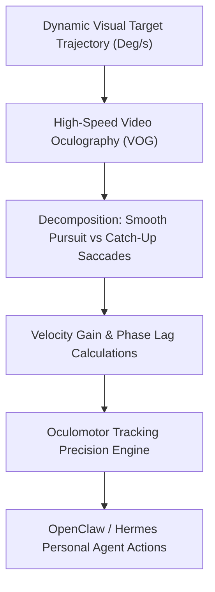

# Oculomotor Smooth Pursuit Tracking Skill

[](LICENSE)
[](https://www.python.org/)
[](requirements.txt)
[](mcp_server.py)
[](SKILL.md)

Zero-dependency sovereign personal agent skill for non-invasive evaluation of Oculomotor Smooth Pursuit gain, retinal velocity error, and saccadic substitution kinetics.



## Features
- **Deterministic Math**: Pure Python standard library implementation with zero external dependencies.
- **Oculomotor Physiology Standards**: Implements clinical eye-tracking velocity gain and phase angle calculations.
- **Visual Fatigue & Attention Biomarker**: Quantifies cognitive decoupling and saccadic substitution.
- **Model Context Protocol (MCP)**: Native JSON-RPC tool integration for LLMs and autonomous agents.

## Quickstart

```python
from client import OculomotorSmoothPursuitClient

client = OculomotorSmoothPursuitClient()
result = client.evaluate_smooth_pursuit(
    target_velocity_deg_s=20.0,
    eye_smooth_velocity_deg_s=19.4
)
print("Pursuit Gain:", result["smooth_pursuit_gain"])
print("Classification:", result["classification"])
```

## License
Apache-2.0
